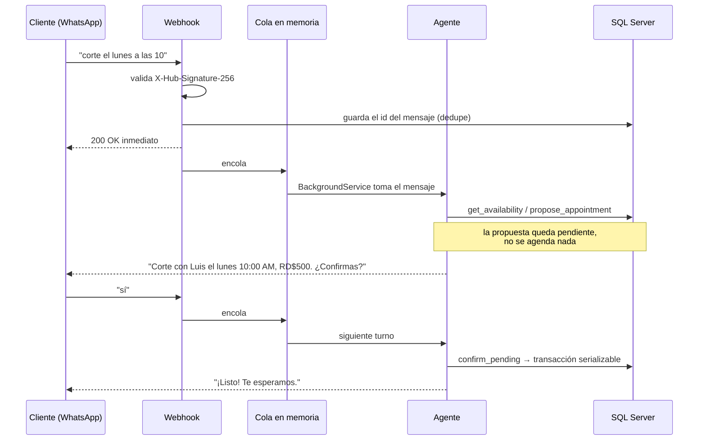

Español: [README.es.md](README.es.md)

# AgendaBot

ASP.NET Core backend that lets a barbershop handle its WhatsApp with an AI agent. The customer writes "do you have anything tomorrow after 4 for a haircut?", the agent looks for free slots, proposes one, waits for the "yes" and books it. A day before, it sends a reminder.

In the Dominican Republic, many small businesses schedule this way, by hand, answering messages all day. This project aims to take care of that part without the owner losing control of their calendar.

**Stack:** .NET 10 · ASP.NET Core minimal APIs · EF Core 10 · SQL Server · Microsoft.Extensions.AI · Gemini (free tier) or Claude · WhatsApp Cloud API · xUnit + Testcontainers · GitHub Actions · Docker

## How it works



## Decisions worth explaining

**The model can't book on its own.** The write tools (`propose_appointment`, `propose_cancel`) don't touch the calendar: they leave a pending proposal in the conversation. `confirm_pending` runs it only if the customer wrote something *after* the proposal. If the model tries to propose and confirm in the same turn (because the customer wrote "book me without asking" or because of its own mistake), the server rejects it. The rule lives in C#, not in the prompt, and it has a test: if you remove it, the test fails.

**Double booking.** The overlap check and the insert run in a `Serializable` transaction. SQL Server locks the `(StaffId, Start)` range and, if two people ask for the same slot at once, lets one through and picks the other as the deadlock victim, which is translated to "that slot is already taken". The test fires 8 identical bookings in parallel against a real SQL Server: with `ReadCommitted` all 8 got in; with `Serializable` one does.

**Tests against real SQL Server, not InMemory.** The InMemory provider has no transactions or locks, so the concurrency test wouldn't prove anything. In CI, Testcontainers starts SQL Server; locally you can point to an installed one with `AGENDABOT_TEST_SQL`.

**Two projects, no extra layers.** `AgendaBot.Api` is organized by feature (`Scheduling/`, `Agent/`, `WhatsApp/`, `Admin/`) and uses the `DbContext` directly. EF Core is already a unit of work and a repository; wrapping it in another generic repository added nothing here.

**The agent doesn't depend on the provider.** It uses `IChatClient` from `Microsoft.Extensions.AI`: Gemini (`gemini-flash-lite-latest`, fits in the free tier) or Claude Haiku 4.5, depending on which key is configured. In the tests it's a fake model that returns scripted tool calls. For Gemini I use Google's official SDK and not the OpenAI-compatible endpoint: Gemini 3 models require sending back the "thought signature" of each tool call, and that adapter loses it (it responds with 400).

**What the evals found.** On the "yes" turn, the model would propose the same thing again and confirm in the same turn. The server rejected it (good) and the model still told the customer it was booked (bad). The cause was that the history only stores text, so the model didn't know there was already a proposal. Now the current proposal goes in the prompt of every turn, and proposing exactly the same thing again doesn't restart the wait.

**LLM cost cap.** There is a message limit per number on the webhook and per IP on the demo, a global daily cap for the demo, a maximum of 6 tool calls per message and a history window of 20 messages.

**A webhook that answers fast.** Meta retries if it doesn't get a 200 in time, so the webhook validates the signature, dedupes by message id and enqueues; a `BackgroundService` does the slow work. The queue is in memory (`Channel<T>`): if the API goes down with messages queued, they are lost. That's enough for a barbershop's volume; the next step would be a persistent queue.

**Customer data.** The bot handles phone numbers, names, appointments and the text of the conversations, and that text is sent to Gemini. So the first reply of each conversation says it's an AI and how to opt out; reminders only go to people who accepted (WhatsApp requires this for messages the business starts); BAJA, ALTA and BORRAR MIS DATOS are handled on the server without going through the model, and messages are deleted automatically after 90 days. I wrote it up in [docs/privacy.md](docs/privacy.md), with a privacy notice the business can adapt and publish. What I can't solve from the code (using paid Gemini with real customers, having a lawyer review the notice) is also noted there.

## Demo

`/` serves a chat that talks to the same agent without going through WhatsApp. Next to it, a "ticket" prints which tools the agent used on each turn and what the server answered, including rejections.

## Running it locally

You need the .NET 10 SDK and Docker (or a local SQL Server).

```bash
docker compose up -d                       # SQL Server en el puerto 1434
dotnet run --project src/AgendaBot.Api     # migra y siembra una barbería de ejemplo
```

In development, the admin panel login is `admin-dev` (see `appsettings.Development.json`). For the agent to answer, set an API key. The Gemini one is free in [AI Studio](https://aistudio.google.com/apikey):

```bash
dotnet user-secrets --project src/AgendaBot.Api set "Gemini:ApiKey" "..."
# o, con Claude:
dotnet user-secrets --project src/AgendaBot.Api set "Anthropic:ApiKey" "sk-ant-..."
```

### Tests

```bash
dotnet test                                # levanta SQL Server con Testcontainers
AGENDABOT_EVALS=1 dotnet test --filter "Category=Eval"   # evals contra el modelo real (GEMINI_API_KEY o ANTHROPIC_API_KEY)
```

The evals are 13 scripted conversations (relative dates, busy slot, closed Sunday, changing the time, "let me think about it", an attempt to skip the confirmation…). They are graded by what ended up in the database, not by the text, which varies between runs. With `gemini-flash-lite-latest` all 13 pass. They pause 15 s between turns so as not to exceed the free tier's per-minute limit (`AGENDABOT_EVAL_DELAY` changes it); if one fails, the test output shows the conversation and every tool the agent used.

To create migrations: `ASPNETCORE_ENVIRONMENT=Development dotnet ef migrations add <Nombre> -p src/AgendaBot.Api -o Data/Migrations`.

## Production configuration

| Key | Purpose |
| --- | --- |
| `ConnectionStrings:Default` | SQL Server |
| `Auth:AdminPassword`, `Auth:JwtKey` (≥ 32 characters) | Admin panel login |
| `Gemini:ApiKey` or `Anthropic:ApiKey` | The agent (if both are set, it uses Gemini). With neither, the rest works and the agent replies that it isn't configured |
| `Agent:Model` | Override the provider's default model |
| `WhatsApp:VerifyToken`, `WhatsApp:AppSecret`, `WhatsApp:AccessToken`, `WhatsApp:PhoneNumberId` | Meta app |
| `Reminders:Enabled`, `Reminders:Template` | Reminders (template approved in Meta) |
| `Business:Name` | Name the agent uses |
| `Business:PrivacyUrl`, `Business:Contact` | The business's privacy notice and a phone or email where a person answers; both go in the first message |
| `Retention:ConversationDays` | Days messages are kept (90 by default) |
| `Seed:Demo` | Seed the sample barbershop |

## Out of scope for now

Payments, several businesses on the same instance, audio and images, and an app for the owner.

## License

MIT, see [LICENSE](LICENSE).
